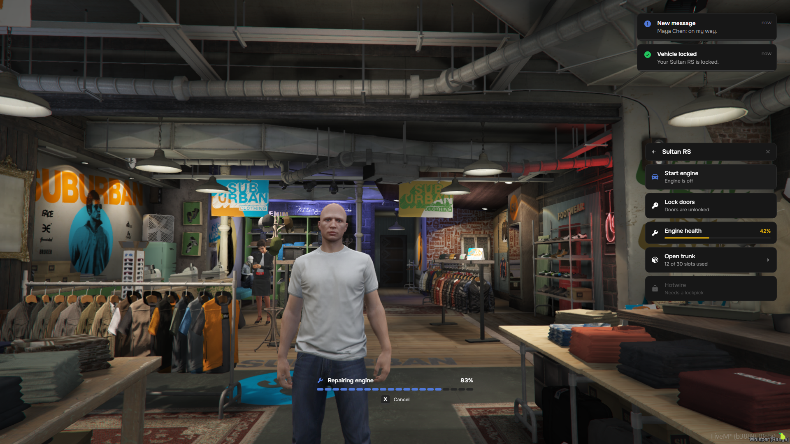

# cobalt_interfaces

UI library: notifications, progress bars, text UI, skill checks, context and radial menus, and dialogs.

Documentation: https://docs.projectcobalt.net/cobalt_interfaces

Part of [Project Cobalt](https://github.com/Project-Cobalt-FiveM), under the [Project Cobalt License](LICENSE).
